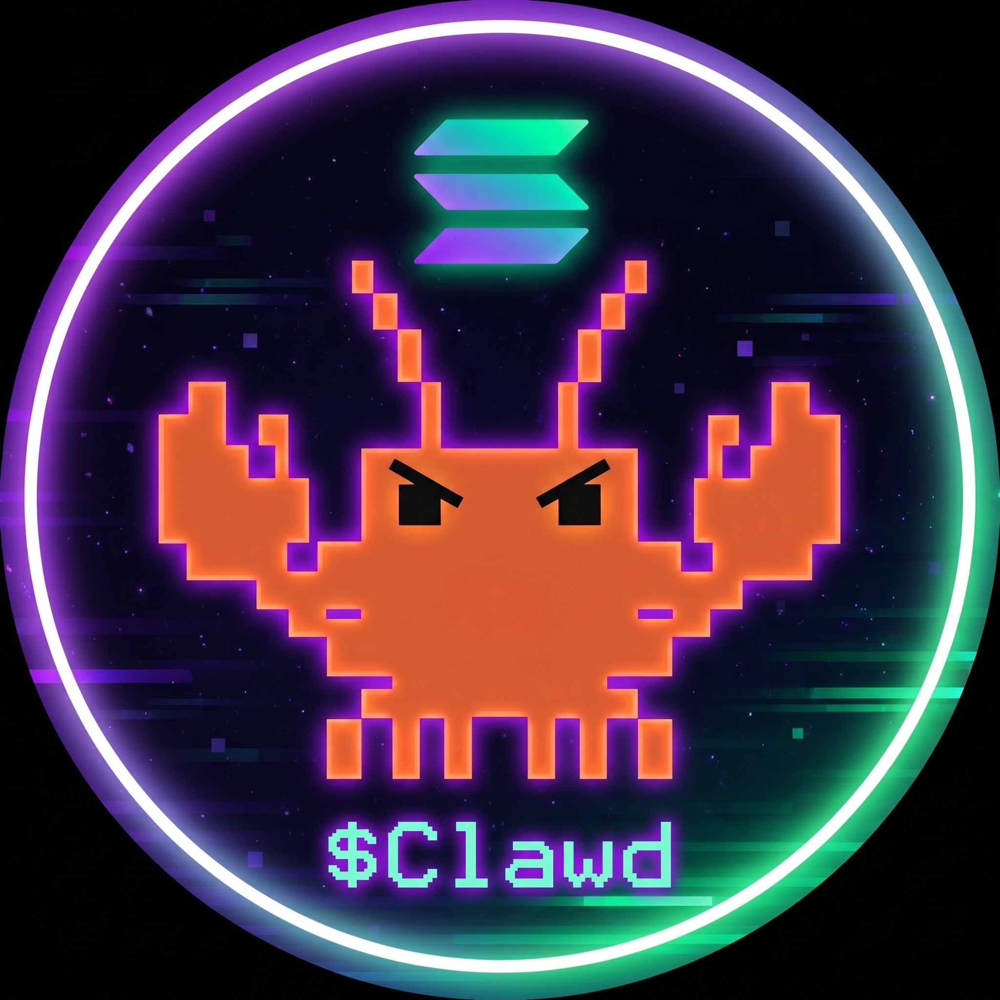

<div align="center">



```text
███████╗ ██████╗ ██╗      █████╗ ███╗   ██╗ █████╗      ██████╗ ███████╗
██╔════╝██╔═══██╗██║     ██╔══██╗████╗  ██║██╔══██╗    ██╔═══██╗██╔════╝
███████╗██║   ██║██║     ███████║██╔██╗ ██║███████║    ██║   ██║███████╗
╚════██║██║   ██║██║     ██╔══██║██║╚██╗██║██╔══██║    ██║   ██║╚════██║
███████║╚██████╔╝███████╗██║  ██║██║ ╚████║██║  ██║    ╚██████╔╝███████║
╚══════╝ ╚═════╝ ╚══════╝╚═╝  ╚═╝╚═╝  ╚═══╝╚═╝  ╚═╝     ╚═════╝ ╚══════╝
```

# OpenClawd — Solana OS

> **The sovereign operator stack. Terminal-first. Agent-native. Pay-per-thought.**

<p>
  <a href="LICENSE"></a>
  <a href="https://terminal.solanaos.net"></a>
  <a href="solana-clawd-x402/README.md"></a>
  <a href="TOKEN.md"></a>
  <a href="docs/getting-started.md"></a>
</p>

</div>

```text
[ BOOT SEQUENCE ]
> init shell....................... OK
> load operator memory............. OK
> sync Solana RPC.................. OK
> mount ClawdBot surfaces.......... OK
> register lobster TUI............. OK
> enable x402 payment rails........ OK
> verify $CLAWD holding............ OK
> route inference budget........... OK
> status........................... OPENCLAWD ONLINE
```

OpenClawd is a cypherpunk Solana operator stack — terminal-first, agent-native, and token-gated. It blends a Go daemon, TypeScript agent runtime, Electron desktop app, x402 payment rails, on-chain Metaplex agent registry, and DeFi tooling into one public monorepo.

Access to [terminal.solanaos.net](https://terminal.solanaos.net) requires **100,000 $CLAWD** — the terminal is sovereign infrastructure for holders.

---

## What This Is

```text
┌─────────────────────────────────────────────────────────────────────────┐
│                           OPENCLAWD STACK                               │
├───────────────────┬─────────────────────┬───────────────────────────────┤
│  RUNTIME / INFRA  │   AGENT + PAYMENTS  │   DeFi / On-Chain             │
├───────────────────┼─────────────────────┼───────────────────────────────┤
│  cmd/mawdbot (Go) │  solana-clawd/      │  solana-clawd/dark-defi/      │
│  mcp-server/      │  solana-clawd-x402/ │  solana-clawd/vulcan-cli-master│
│  services/        │  solana-clawd/mcp/  │  solana-clawd/perps/          │
│  workers/         │  solana-clawd/agents│  solana-clawd/programs/       │
├───────────────────┼─────────────────────┼───────────────────────────────┤
│  TERMINAL / UI    │   AUTOMATION        │   DOCS / SKILLS               │
├───────────────────┼─────────────────────┼───────────────────────────────┤
│  ui/ (Lit/Vite)   │  solana-clawd/ooda/ │  docs/                        │
│  cmd/mawdbot-tui  │  solana-clawd/      │  skills/                      │
│  WatchApp/        │  automaton-main/    │  SOUL.md                      │
│  apps/clawd-dmg   │  solana-clawd/      │  strategy.md                  │
│  chrome-extension │  leviathan/         │  TOKEN.md                     │
└───────────────────┴─────────────────────┴───────────────────────────────┘
```

---

## $CLAWD Token Gate

The terminal runs token-gated access via on-chain $CLAWD balance verification:

- **Mint:** `8cHzQHUS2s2h8TzCmfqPKYiM4dSt4roa3n7MyRLApump`
- **Minimum:** 100,000 $CLAWD
- **Gate flow:** Wallet connect → challenge → Phantom signature → Helius RPC verify → JWT session

No $CLAWD, no entry. Fail-closed: RPC outage returns 403, never bypass.

> Token gate implementation: [`api/auth/`](./api/auth/) · [`lib/clawd/`](./lib/clawd/) · [`middleware.ts`](./middleware.ts)

---

## Modules

| Path | Purpose |
|------|---------|
| [`solana-clawd/`](./solana-clawd/) | Full TypeScript agent engine — gateway, MCP, agents, skills, ooda |
| [`solana-clawd/agents/`](./solana-clawd/agents/) | Modular agent definitions and task runners |
| [`solana-clawd/dark-defi/`](./solana-clawd/dark-defi/) | Privacy-first DeFi protocol layer |
| [`solana-clawd/vulcan-cli-master/`](./solana-clawd/vulcan-cli-master/) | Phoenix DEX perps CLI + grid/TWAP trading |
| [`solana-clawd/perps/`](./solana-clawd/perps/) | Perpetuals integrations (Aster, Hyperliquid) |
| [`solana-clawd/mcp/`](./solana-clawd/mcp/) | MCP server packages |
| [`solana-clawd/leviathan/`](./solana-clawd/leviathan/) | OODA-loop autonomous agent orchestrator |
| [`solana-clawd/automaton-main/`](./solana-clawd/automaton-main/) | Automaton workflow engine |
| [`solana-clawd/a2a-x402-main/`](./solana-clawd/a2a-x402-main/) | A2A + x402 agent-to-agent payment protocol |
| [`solana-clawd/programs/`](./solana-clawd/programs/) | Anchor/Pinocchio on-chain programs |
| [`solana-clawd/operator/`](./solana-clawd/operator/) | Operator control plane |
| [`solana-clawd/pump-fun/`](./solana-clawd/pump-fun/) | pump.fun launch tooling |
| [`solana-clawd-x402/`](./solana-clawd-x402/) | x402 payment protocol — Cloudflare worker + SDK + Anchor vault |
| [`apps/clawd-desktop-main/`](./solana-clawd/apps/clawd-desktop-main/) | Electron desktop app with Agent Explorer, Solana screen, Vault |
| [`cmd/mawdbot/`](./cmd/mawdbot/) | Go CLI daemon |
| [`cmd/mawdbot-tui/`](./cmd/mawdbot-tui/) | Lobster TUI surface |
| [`ui/`](./ui/) | Browser control surface (Lit/Vite, served at terminal.solanaos.net) |
| [`mcp-server/`](./mcp-server/) | Standalone MCP server |
| [`skills/`](./skills/) | Operator skill catalog |
| [`docs/`](./docs/) | Architecture, deployment, strategy |
| [`api/auth/`](./api/auth/) | Token gate API (challenge/verify/logout) |
| [`lib/clawd/`](./lib/clawd/) | Shared gate logic (clawdHolding, phantomAuth) |
| [`WatchApp/`](./WatchApp/) | Apple Watch companion |
| [`chrome-extension/`](./chrome-extension/) | Browser extension surface |

---

## Hermes x402 — Private Inference Loop

> **Trade → Earn USDC → Pay x402 → Think → Trade Better**

```text
┌─────────────────────────────────────────────────────┐
│               PRIVATE HERMES AGENT LOOP             │
│                                                     │
│   Trade Solana ──▶ Earn USDC ──▶ Pay x402 ──▶ Think │
│        ▲                                            │
│        └──────────── feedback + learning ───────────┘
└─────────────────────────────────────────────────────┘
```

The wallet is the credential. Payment is part of the request flow. No API accounts required.

→ [solana-clawd-x402/README.md](./solana-clawd-x402/README.md) · [EXAMPLE.md](./solana-clawd-x402/EXAMPLE.md)

---

## Quick Start

```bash
git clone https://github.com/x402agent/Solana-Os-Go.git
cd Solana-Os-Go
npm install
cp .env.example .env
# Fill in HELIUS_RPC_URL, SOLANA_PRIVATE_KEY, and your LLM keys
```

### Run the Go daemon

```bash
make run
# or: go run main.go
```

### Run the control UI (dev)

```bash
cd ui && npm install && npm run dev
# → http://localhost:5173
```

### x402 worker

```bash
cd solana-clawd-x402/worker
npm install && npm run dev
```

### Desktop app

```bash
cd solana-clawd/apps/clawd-desktop-main
npm install && npm run dev
```

---

## Security

**Do not commit:**
- `.env` files or `.env.local`
- private keys or wallet exports
- webhook secrets or paid-provider credentials
- Android signing keys (`.jks`, `.keystore`)

The `.gitignore` is configured to exclude all of the above. See [SECURITY.md](./SECURITY.md).

TruffleHog secret scanning runs on every PR via [`.github/workflows/trufflehog.yml`](./.github/workflows/trufflehog.yml).

---

## Reading Order

1. [SOUL.md](./SOUL.md) — operator identity and values
2. [docs/getting-started.md](./docs/getting-started.md)
3. [docs/architecture.md](./docs/architecture.md)
4. [strategy.md](./strategy.md)
5. [TOKEN.md](./TOKEN.md) — $CLAWD token
6. [solana-clawd-x402/README.md](./solana-clawd-x402/README.md)
7. [DAEMON.md](./DAEMON.md) — Go daemon internals

---

## Design Language

```text
╔══════════════════════════════════════════════════════════════╗
║ OPENCLAWD TERMINAL // SOLANA OS // CLAWDBOT CONTROL SURFACE ║
╠══════════════════════════════════════════════════════════════╣
║ wallet      : connected                                      ║
║ rpc         : healthy                                        ║
║ memory      : mounted                                        ║
║ x402        : armed                                          ║
║ $CLAWD gate : verified                                       ║
║ operator    : lobster mode                                   ║
╚══════════════════════════════════════════════════════════════╝
```

Cypherpunk terminal aesthetics. Solana-native neon palette. Professional operator tone — not meme spam.

---

## License

MIT — see [LICENSE](./LICENSE).

<div align="center">

```text
   🦞  THE SHELL MOLTS. THE OPERATOR REMEMBERS. THE WALLET PAYS.  🦞
```

</div>
