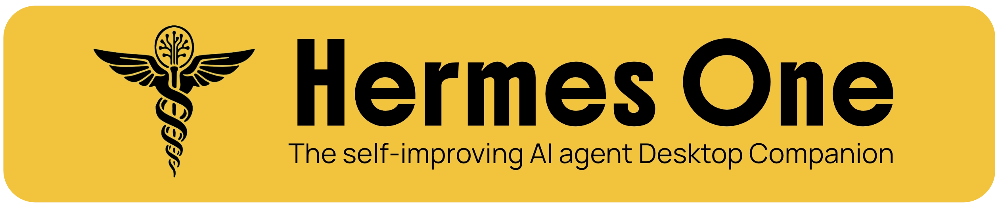

<br/>
<p align="center">
  <a href="https://github.com/x402agent/solana-clawd/blob/main/LICENSE"></a>
  <a href="https://github.com/x402agent/solana-clawd/releases/">
  
</a>
</p>

> **This project is in active development.** Features may change, and some things might break. If you run into a problem or have an idea, [open an issue](https://github.com/x402agent/solana-clawd/issues). Contributions are welcome!

## Languages

- English: `README.md`
- 简体中文: `README.zh-CN.md`
- 日本語: `README.ja-JP.md`
- 🌎 Español (LATAM): `README.es-LATAM.md`

Clawd OS is a native desktop app for installing, configuring, and chatting with the Clawd Agent — a self-improving AI assistant with Solana blockchain integration, tool use, multi-platform messaging, and a closed learning loop.

Instead of managing the CLI by hand, the app walks through install, provider setup, and day-to-day usage in one place. It stores Clawd in `~/.clawd`, and gives you a GUI for chat, sessions, profiles, memory, skills, tools, scheduling, messaging gateways, Solana wallet operations, and more.

## Install

### macOS

Download the latest `Clawd OS.app` from [Releases](https://github.com/x402agent/solana-clawd/releases). Move to `/Applications` and launch.

```bash
# Or build from source:
cd solana-clawd/apps/clawd-desktop-main
npm install
npm run build:mac
open dist/mac-arm64/Clawd\ OS.app
```

### Windows

> **Windows users:** The installer is not code-signed. Windows SmartScreen will warn on first launch — click "More info" → "Run anyway".

> **WSL users:** If the installer stalls at `Switching to root user to install dependencies...`, Playwright is waiting for a sudo password that has no TTY to read from. Grant passwordless sudo for the install, then revert when finished:
>
> ```bash
> echo "$USER ALL=(ALL) NOPASSWD: ALL" | sudo tee /etc/sudoers.d/clawd-install
> # …re-run the installer; once it finishes:
> sudo rm /etc/sudoers.d/clawd-install
> ```

### Fedora (RPM)

```bash
sudo dnf install ./clawd-desktop-<version>.rpm
```

> **Fedora users:** The `.rpm` is not GPG-signed. If your system enforces signature checking, append `--nogpgcheck` to the install command. Auto-update is not supported for `.rpm` builds (limitation of `electron-updater`); reinstall the new `.rpm` to update.

## Preview

<table>
<tr>
<td width="50%" align="center"><b>Chat</b><br/>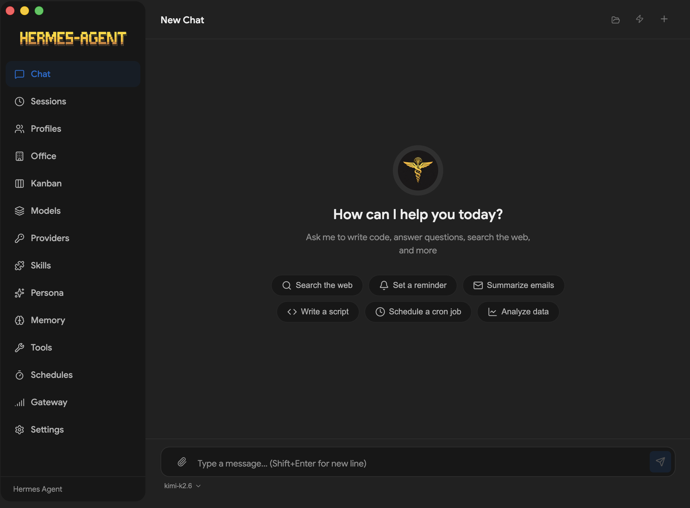</td>
<td width="50%" align="center"><b>Profiles</b><br/>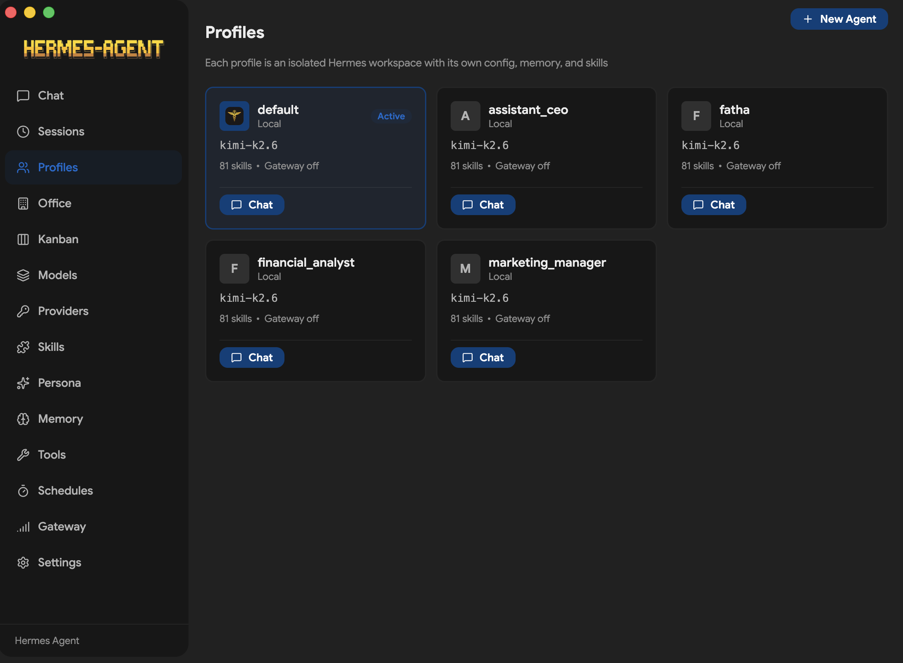</td>
</tr>
<tr>
<td width="50%" align="center"><b>Models</b><br/>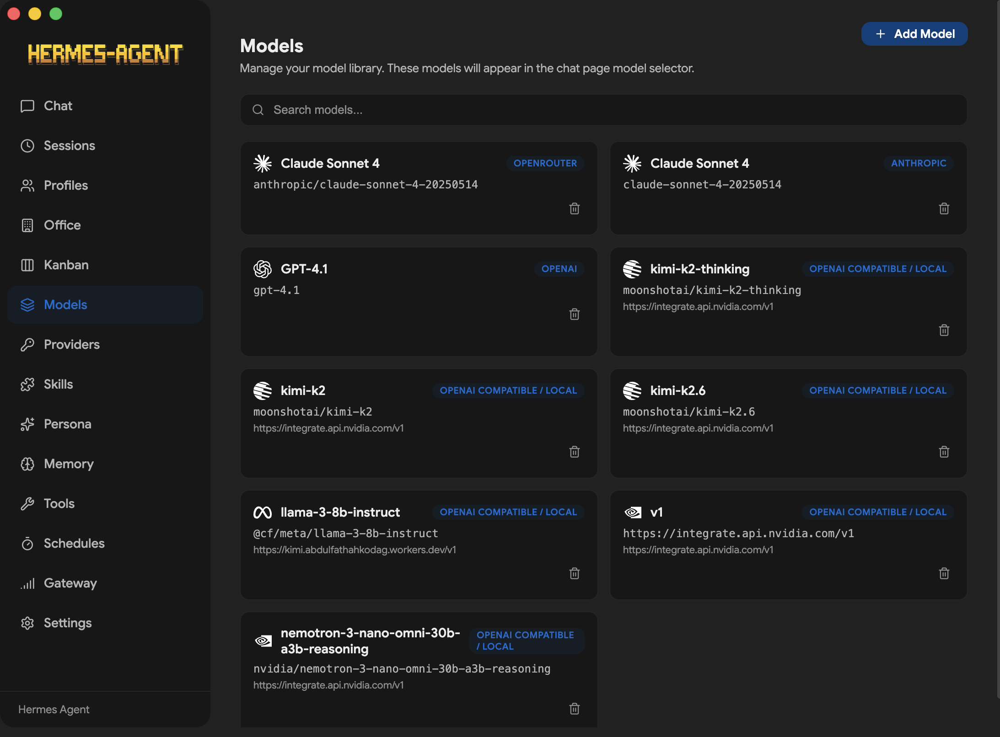</td>
<td width="50%" align="center"><b>Providers</b><br/>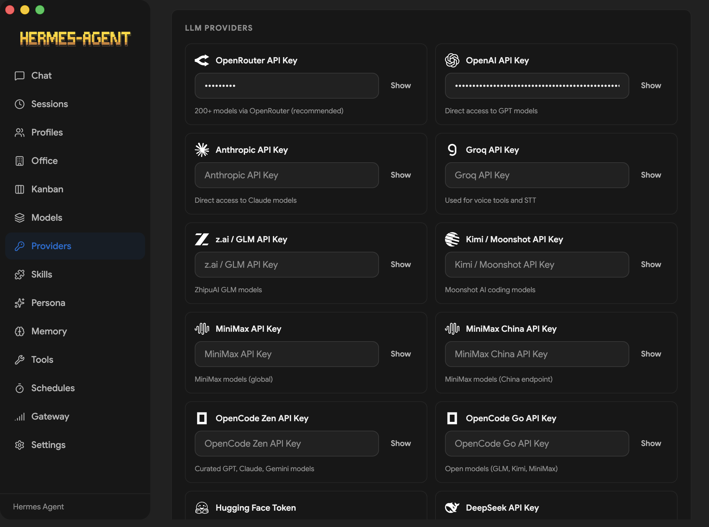</td>
</tr>
<tr>
<td width="50%" align="center"><b>Tools</b><br/>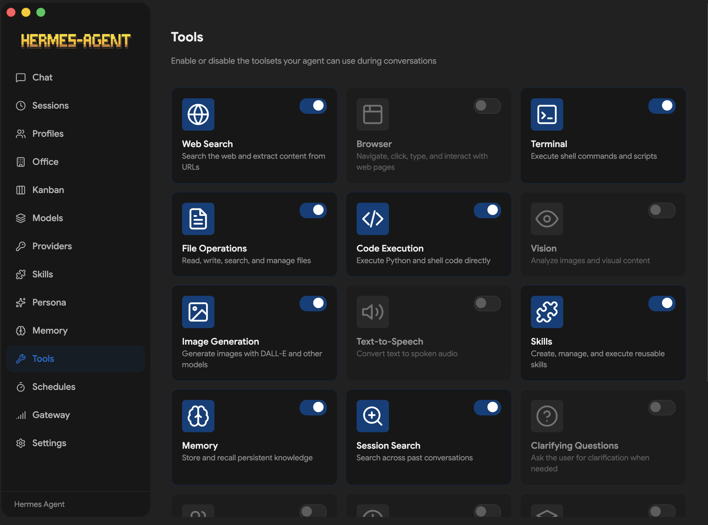</td>
<td width="50%" align="center"><b>Skills</b><br/>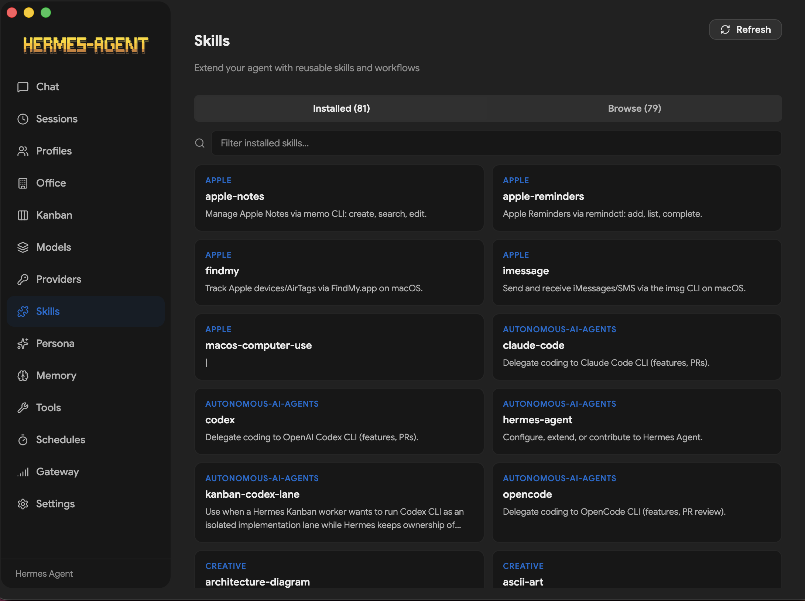</td>
</tr>
<tr>
<td width="50%" align="center"><b>Schedules</b><br/>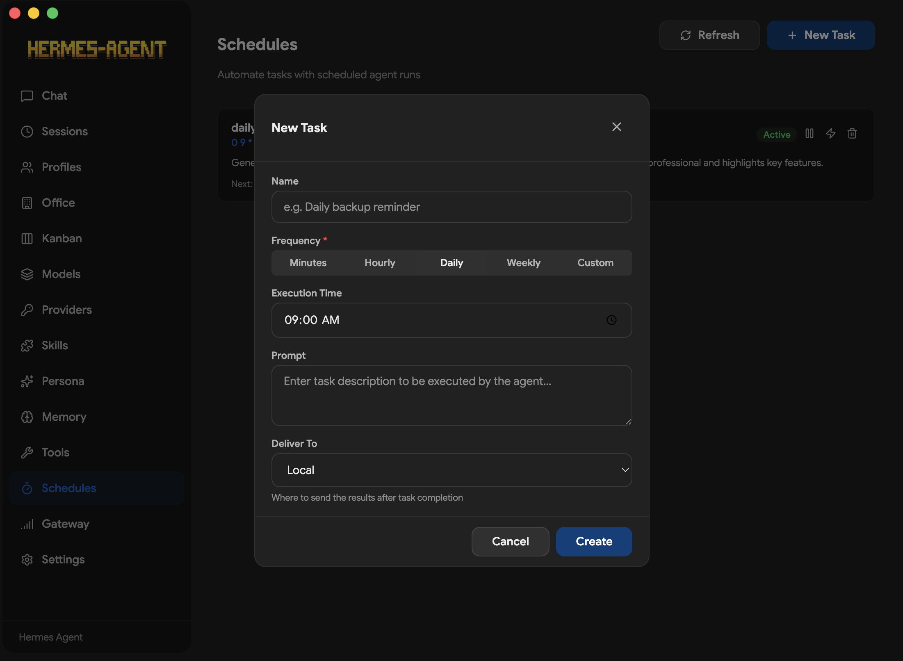</td>
<td width="50%" align="center"><b>Gateway</b><br/>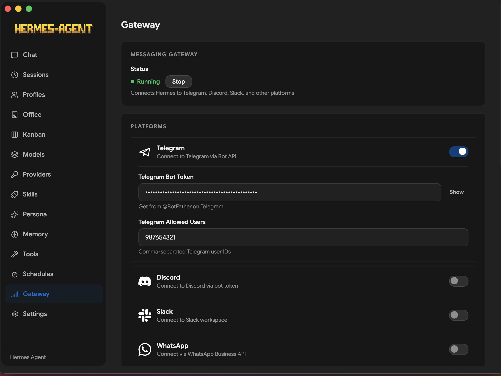</td>
</tr>
<tr>
<td width="50%" align="center"><b>Persona</b><br/>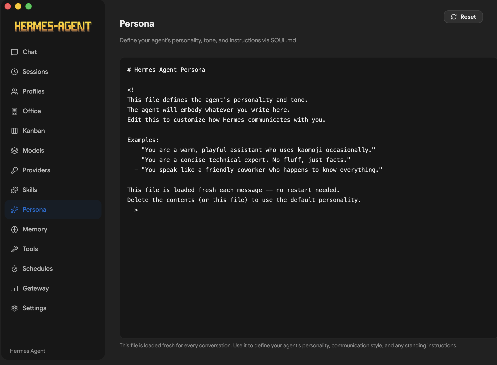</td>
<td width="50%" align="center"><b>Kanban</b><br/>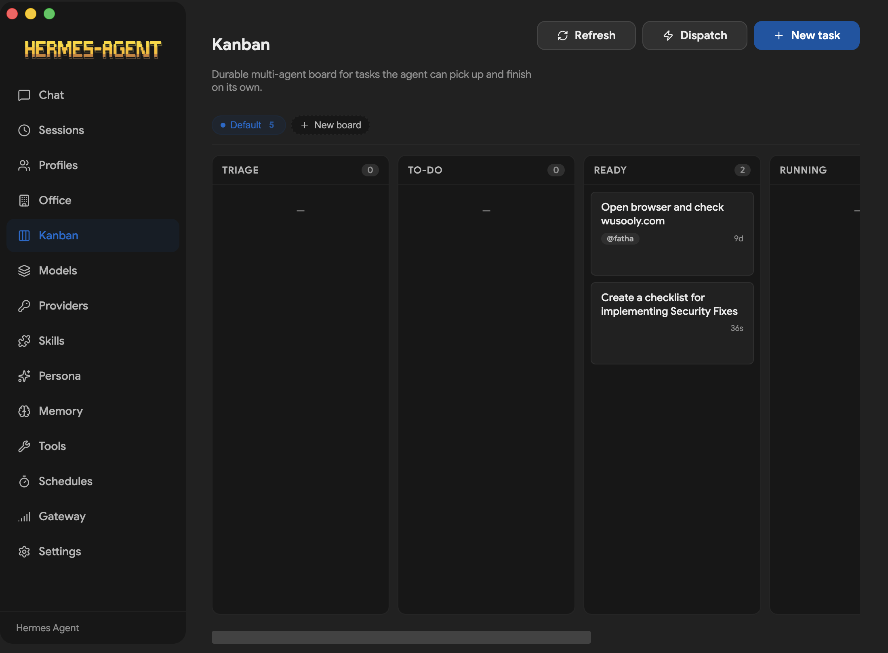</td>
</tr>
<tr>
<td width="50%" align="center"><b>Office</b><br/>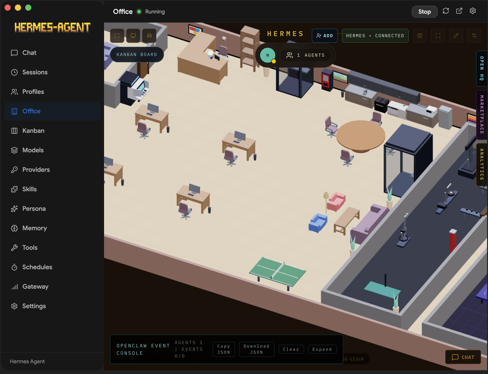</td>
<td width="50%" align="center"><b>Settings</b><br/>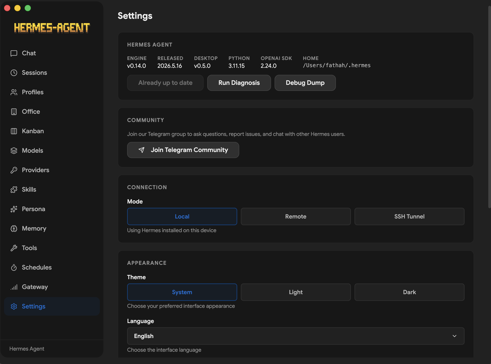</td>
</tr>
</table>

## Features

- **Guided first-run install** for the Clawd Agent with progress tracking and dependency resolution
- **Local or remote backend** — run Clawd locally on `127.0.0.1:8642`, or connect the desktop app to a remote Clawd API server with URL + API key
- **SSH Tunnel mode** — full remote parity: every screen (Chat, Sessions, Skills, Memory, Soul, Tools, Schedules, Gateway, Profiles, Models, Logs) works against a remote VPS via SSH proxy. See the [SSH Tunnel VPS Guide](docs/SSH-TUNNEL-VPS.md)
- **Multi-provider support** — OpenRouter, Anthropic, OpenAI, Google (Gemini), xAI (Grok), Nous Portal, Qwen, MiniMax, Hugging Face, Groq, and local OpenAI-compatible endpoints (LM Studio, Atomic Chat, Ollama, vLLM, llama.cpp)
- **Solana integration** — Helius RPC for wallet balances, token accounts, transaction history, DAS assets, token pricing, and portfolio views. Built-in wallet creation, import, and message signing
- **Streaming chat UI** with SSE streaming, tool progress indicators, markdown rendering, and syntax highlighting
- **Token usage tracking** — live prompt/completion token counts and cost display in the chat footer, plus a `/usage` slash command
- **22 slash commands** — `/new`, `/clear`, `/fast`, `/web`, `/image`, `/browse`, `/code`, `/shell`, `/usage`, `/help`, `/tools`, `/skills`, `/model`, `/memory`, `/persona`, `/version`, `/compact`, `/compress`, `/undo`, `/retry`, `/debug`, `/status`, and more
- **Session management** — full-text search (SQLite FTS5), date-grouped history, resume and search across conversations
- **Profile switching** — create, delete, and switch between separate Clawd environments with isolated config
- **14 toolsets** — web, browser, terminal, file, code execution, vision, image gen, TTS, skills, memory, session search, clarify, delegation, MoA, and task planning
- **Memory system** — view/edit memory entries, user profile memory, capacity tracking, and discoverable memory providers (Honcho, Hindsight, Mem0, RetainDB, Supermemory, ByteRover)
- **Persona editor** — edit and reset your agent's SOUL.md personality
- **Saved models** — CRUD management for model configurations across providers
- **Scheduled tasks** — cron job builder (minutes, hourly, daily, weekly, custom cron) with 15 delivery targets
- **16 messaging gateways** — Telegram, Discord, Slack, WhatsApp, Signal, Matrix, Mattermost, Email (IMAP/SMTP), SMS (Twilio/Vonage), iMessage (BlueBubbles), DingTalk, Feishu/Lark, WeCom, WeChat (iLink Bot), Webhooks, Home Assistant
- **Clawd Office (Claw3D)** — visual 3D interface with dev server and adapter management
- **Agent Wallet** — built-in Solana wallet management with keypair generation, encrypted vault storage, and transaction signing
- **x402 Payments** — HTTP 402 payment-required protocol support for agent-to-agent payments on Solana
- **Voice input** — AssemblyAI speech-to-text transcription and voice agent tokens
- **LiveKit real-time** — WebRTC room and agent token generation for real-time communication
- **Metaplex Agents** — browse and interact with on-chain agent registries
- **Discover marketplace** — community registry for skills, MCPs, and workflows
- **Backup, import & debug dump** — full data backup/restore and system diagnostics from Settings
- **Log viewer** — view gateway and agent logs directly from the Settings screen
- **Auto-updater** — check for and install updates via electron-updater
- **i18n ready** — internationalization framework with 12 language locales, ready for community translations
- **Test suite** — SSE parser, IPC handlers, preload API surface, installer utilities, and constants validation with Vitest

## How It Works

On first launch, the app:

1. Asks whether you want to run Clawd **locally** or connect to a **remote** Clawd API server.
2. **Local mode:** checks whether Clawd is already installed in `~/.clawd`; if not, runs the Clawd installer with dependency resolution (Git, uv, Python 3.11+).
3. **Remote mode:** prompts for the remote API URL and API key, validates the connection, and skips local install.
4. **SSH Tunnel mode:** sets up an SSH tunnel to a remote VPS running the Clawd gateway, proxying every screen through the tunnel for full functionality parity. See [docs/SSH-TUNNEL-VPS.md](docs/SSH-TUNNEL-VPS.md).
5. Prompts for an API provider or local model endpoint.
6. Saves provider config and API keys through Clawd config files.
7. Launches the main workspace once setup is complete.

In local mode, chat requests go through `http://127.0.0.1:8642` with SSE streaming. In remote mode, the app talks to your configured remote URL with the same streaming protocol. The desktop app parses the stream in real time, rendering tool progress, markdown content, and token usage as it arrives.

## Screens

| Screen        | Description                                                                           |
| ------------- | ------------------------------------------------------------------------------------- |
| **Chat**      | Streaming conversation UI with slash commands, tool progress, and token tracking      |
| **Sessions**  | Browse, search, and resume past conversations                                         |
| **Agents**    | Create, delete, and switch between Clawd profiles                                    |
| **Skills**    | Browse, install, and manage bundled and installed skills                              |
| **Models**    | Manage saved model configurations per provider                                        |
| **Memory**    | View/edit memory entries, user profile, and configure memory providers                |
| **Soul**      | Edit the active profile's persona (SOUL.md)                                           |
| **Tools**     | Enable or disable individual toolsets                                                 |
| **Schedules** | Create and manage cron jobs with delivery targets                                     |
| **Gateway**   | Configure and control messaging platform integrations                                 |
| **Office**    | Claw3d visual interface setup and management                                          |
| **Settings**  | Provider config, credential pools, backup/import, log viewer, network settings, theme |

## Supported Providers

### LLM Providers

| Provider            | Notes                                    |
| ------------------- | ---------------------------------------- |
| **OpenRouter**      | 200+ models via single API (recommended) |
| **Anthropic**       | Direct Claude access                     |
| **OpenAI**          | Direct GPT access                        |
| **Google (Gemini)** | Google AI Studio                         |
| **xAI (Grok)**      | Grok models                              |
| **Nous Portal**     | Free tier available                      |
| **Qwen**            | QwenAI models                            |
| **MiniMax**         | Global and China endpoints               |
| **Hugging Face**    | 20+ open models via HF Inference         |
| **Groq**            | Fast inference (voice/STT)               |
| **Local/Custom**    | Any OpenAI-compatible endpoint           |

Local presets are included for LM Studio, Atomic Chat, Ollama, vLLM, and llama.cpp.

### Messaging Platforms

Telegram, Discord, Slack, WhatsApp, Signal, Matrix/Element, Mattermost, Email (IMAP/SMTP), SMS (Twilio & Vonage), iMessage (BlueBubbles), DingTalk, Feishu/Lark, WeCom, WeChat (iLink Bot), Webhooks, and Home Assistant.

### Tool Integrations

Exa Search, Parallel API, Tavily, Firecrawl, FAL.ai (image generation), Honcho, Browserbase, Weights & Biases, and Tinker.

## Solana Integration

Clawd OS provides deep Solana blockchain integration through:

- **Helius RPC** — wallet balances, token accounts, transaction history, DAS (Digital Asset Standard) queries, token pricing, and portfolio aggregation
- **Wallet Management** — create new wallets, import existing ones via secret key, export secrets, sign messages and transactions
- **Agent Wallet Vault** — encrypted local storage for Solana keypairs with NaCl secretbox
- **x402 Payments** — HTTP 402 Payment Required protocol integration for agent-to-agent micropayments on Solana
- **Metaplex Agents** — query the Metaplex Agent Registry for on-chain AI agents
- **Phoenix DEX Perps** — perpetual futures trading via the `@openclawdsolana/clawd-perps` integration

## Remote Connectivity

Clawd OS supports three connection modes:

| Mode | Description | Full Feature Parity |
|------|-------------|---------------------|
| **Local** | Clawd gateway runs on localhost:8642 | ✅ All screens |
| **Remote (HTTP)** | Connect to a remote Clawd API via URL + API key | ❌ Chat only |
| **SSH Tunnel** | SSH tunnel proxies all screens to a remote VPS | ✅ All screens |

For complete setup instructions, see the [SSH Tunnel VPS Guide](docs/SSH-TUNNEL-VPS.md).

## Development

### Prerequisites

- Node.js and npm
- A Unix-like shell environment for the Clawd installer
- Network access for downloading Clawd during first-run install

### Install dependencies

```bash
npm install
```

### Start the app in development

```bash
npm run dev
```

### Run checks

```bash
npm run lint
npm run typecheck
```

### Run tests

```bash
npm run test
npm run test:watch
```

### Build the desktop app

```bash
npm run build
```

Platform packaging:

```bash
npm run build:mac
npm run build:win
npm run build:linux
npm run build:rpm    # Fedora/RHEL .rpm only
```

## First-Time Setup

When the app opens for the first time, it will either detect an existing Clawd installation or offer to install it for you.

Supported setup paths in the UI:

- `OpenRouter`
- `Anthropic`
- `OpenAI`
- `Local LLM` via an OpenAI-compatible base URL

Local presets are included for:

- LM Studio
- Atomic Chat
- Ollama
- vLLM
- llama.cpp

Clawd files are managed in:

- `~/.clawd`
- `~/.clawd/.env`
- `~/.clawd/config.yaml`
- `~/.clawd/clawd-agent`
- `~/.clawd/profiles/` — named profile directories
- `~/.clawd/state.db` — session history database
- `~/.clawd/cron/jobs.json` — scheduled tasks

## Project Structure

```text
src/main/                Electron main process, IPC handlers, Clawd integration
src/main/clawd.ts        Core chat/streaming/API gateway client
src/main/clawd-auth.ts   OAuth provider authentication flows
src/main/installer.ts    Clawd Agent install, dependency resolution
src/main/config.ts       Profile-aware configuration management
src/main/ssh-tunnel.ts   SSH tunnel for remote VPS connectivity
src/main/helius.ts       Helius RPC Solana integration
src/main/assemblyai.ts   Speech-to-text voice transcription
src/main/livekit.ts      WebRTC real-time communication
src/main/metaplex-agents.ts  On-chain agent registry queries
src/main/agent-wallet.ts     Solana wallet management
src/main/vault.ts            Encrypted key storage
src/preload/                 Secure renderer bridge
src/renderer/src/            React app and UI components
resources/                   App icons and packaged assets
build/                       Packaging resources
```

## Tech Stack

- **Electron** 39 — cross-platform desktop shell
- **React** 19 — UI framework
- **TypeScript** 5.9 — type safety across main and renderer processes
- **Tailwind CSS** 4 — utility-first styling
- **Vite** 7 + electron-vite — fast dev server and build tooling
- **better-sqlite3** — local session storage with FTS5 full-text search
- **@solana/web3.js** — Solana blockchain interaction
- **tweetnacl + bs58** — cryptographic key management
- **i18next** — internationalization framework (12 locales)
- **Vitest** — test runner

## Notes

- The desktop app depends on the upstream Clawd Agent project for agent behavior and tool execution.
- The built-in installer runs the official Clawd install script, then completes provider configuration in the GUI.
- Local model providers do not require an API key, but the compatible server must already be running.
- For SSH tunnel mode, the remote VPS must have the Clawd gateway running on `localhost:8642` and SSH access configured. See the [SSH Tunnel VPS Guide](docs/SSH-TUNNEL-VPS.md).
- The app runs as an `LSUIElement` (menu bar only) on macOS — no dock icon. All interaction happens through the menu bar.

## Contributing

Contributions are welcome! Check out the [Contributing Guide](CONTRIBUTING.md) to get started. If you're not sure where to begin, take a look at the [open issues](https://github.com/x402agent/solana-clawd/issues). Found a bug or have a feature request? [File an issue](https://github.com/x402agent/solana-clawd/issues/new).

## Related Projects

- **Clawd Agent** — the core AI agent runtime and CLI
- **Solana OS** — the full Solana AI operating system monorepo
- **Clawd Browser** — web-based companion interface
- **Clawd Perps** — Phoenix DEX perpetual futures on Solana

## License

MIT License — see [LICENSE](LICENSE) for details.